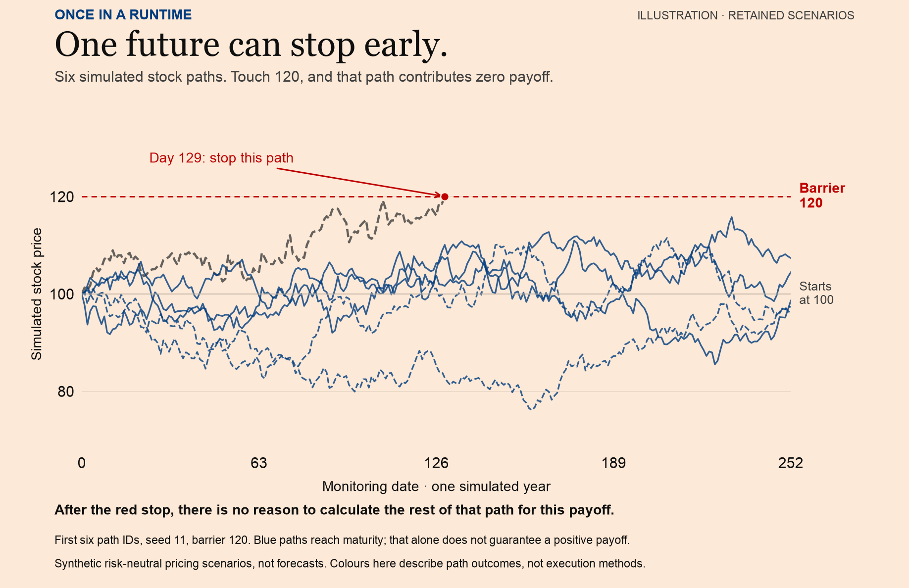
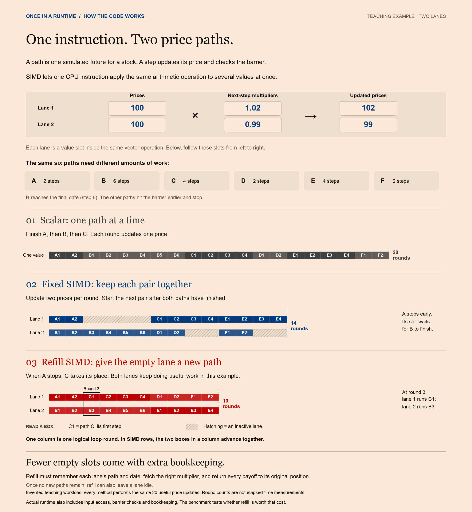
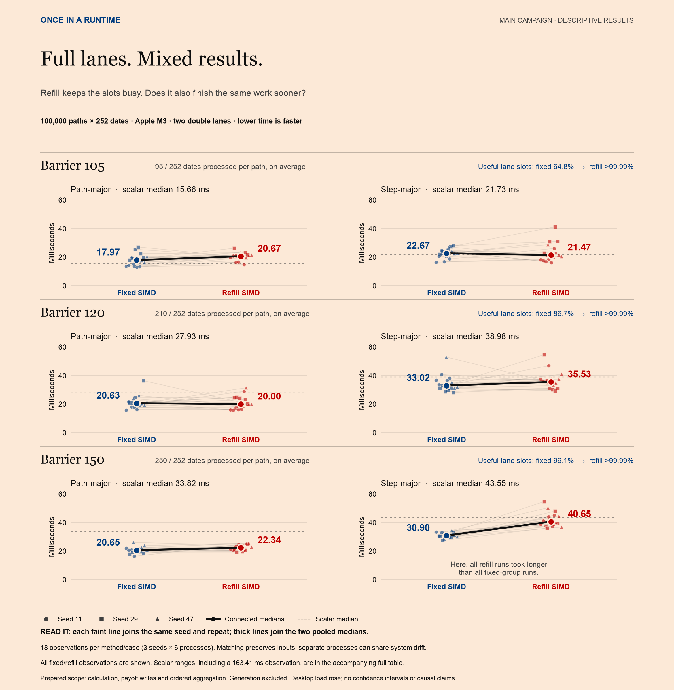
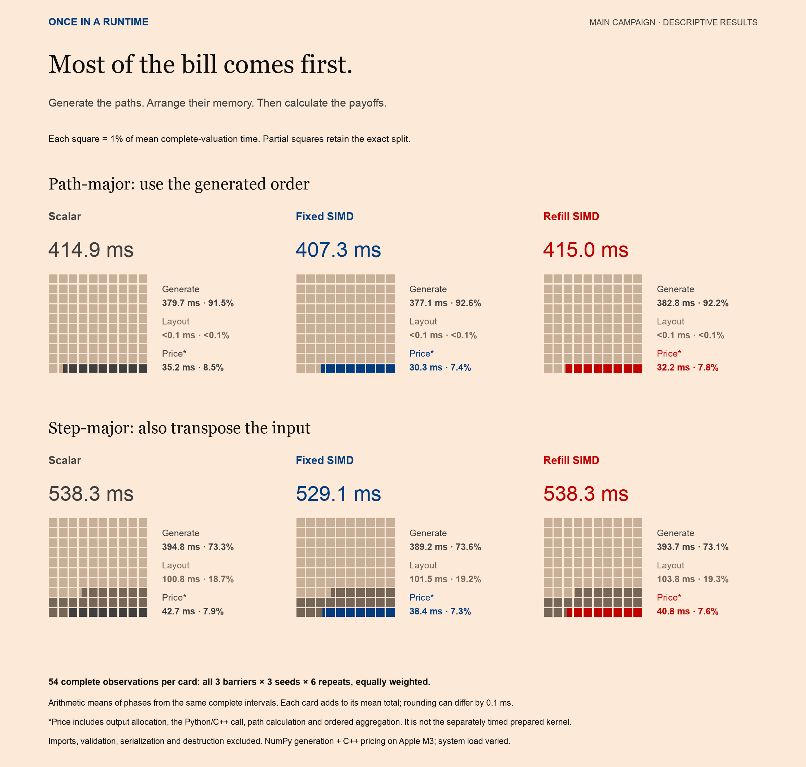

# When an option disappears, what happens to its SIMD lane?

I only discovered Interactive Brokers, the trading platform, about four years ago, well after my chances of becoming a teenage trading prodigy had passed. I started out trading more or less at random, and it went about as well as you'd expect.

But I did become fascinated by options. These are financial contracts with rules about what you might receive in the future, depending on things such as how a stock price moves. I wanted to understand how you put a price on that today, without knowing what will happen tomorrow. And as I tried to make sense of it, I started wondering what I'd actually have to write to make a computer do the calculation.

That's what I want to work through here, with one example and a small C++ program. I'm learning the finance along the way too, so we'll start with what the contract means and explain what we need as we go. Once the calculation makes sense, we can look at whether there's a faster way to do it.

Suppose a stock is trading at 100, and we're looking at an option that pays whatever the stock finishes above 100 in a year's time. If it finishes at 110, the payout is 10. If it finishes at or below 100, the payout is zero. Now add a condition: if the stock reaches or passes 120 on one of our checking dates, the option is cancelled. Even if it later falls back to 110, we receive nothing. The contract has a very good memory for inconvenient events.

That's an *up-and-out call*: “up” because the barrier is above the starting price, and “out” because reaching it ends the contract. I'll use 252 equally spaced checking dates, including the final one, and no payment when the option is cancelled. This is a contract with scheduled checks; a price movement between those checks won't trigger the barrier in our example.

A buyer might accept this restriction because it can make the option cheaper than an otherwise equivalent call without the barrier. They give up the payout in some possible futures in exchange for a lower upfront cost. [ICE's explanation of barrier options](https://idd.ice.com/CM/CMHelp/Content/FM/Barrier_Options.htm) describes that tradeoff.

The next question is what to charge for the option today. One way to estimate that is to generate many possible price histories under a pricing model, work out the payout in each, then average the payouts and adjust them back to today's value. That's the Monte Carlo approach we'll use. Each price history is called a *path*, and all those paths are alternative futures for the same contract. They don't predict which future we'll actually get.

*Six paths from one of the simulated inputs. A path stops as soon as it reaches the barrier on a checking date. A path that reaches maturity can still pay zero.*

Now we can follow one path through the code. Update the price, check the barrier, repeat. As soon as it reaches 120, we know its payout will be zero, so we can leave that path and start the next. This is an ordinary loop with an early exit, and it's the version I want the more elaborate code to beat. It already avoids work whose answer we know.

Following one path at a time makes that decision straightforward. I also want to try advancing several paths together, which means deciding what to do when one finishes before its neighbours.

This is where SIMD comes in: one CPU instruction can apply the same operation to several values. We can use that to update several simulated prices together, with a path in each position, or *lane*. On my M3 MacBook Air, the native type we'll use holds two `double` values, so we have two lanes to work with. Imagine putting two paths into those positions and advancing them together until both are finished.

Suppose the first path hits the barrier at date 20, but the second makes it all the way to date 252. We can mark the first lane as inactive; the group still has to keep going for its neighbour. In this fixed-group version, the empty position waits until we're ready to start another pair.

I'd like to try putting the next path into that position straight away. This is **lane refill**, and the catch is that the new path starts at its own beginning. Its neighbour might be on date 200 while it's on date 1. The program now has to remember which path is where, find the right next input for each one, and put every answer back in the right place.

Think of a kitchen that starts two orders together and waits for both to finish before starting the next pair. If one customer cancels, a workstation sits empty while the other order continues. Letting a new order take that place sounds sensible, until you count fetching the ingredients, changing the ticket and keeping track of two orders at different stages. Those little jobs are part of getting dinner out of the kitchen.

The CPU version has those costs too. And unlike two cooks, the lanes share the same arithmetic instruction: refill has to line up the correct inputs so that instruction can advance both paths. I want to find out whether keeping the lanes busier saves enough time to pay for arranging the work.

*In this small example, a fixed group leaves a lane empty until the next group starts. Refill gives it another path right away. The numbered rounds show the order of updates.*

There's already plenty of background on parallel option pricing. Yi Dong's [NVIDIA article from 19 March 2020](https://developer.nvidia.com/blog/accelerating-python-for-exotic-option-pricing/) uses a GPU to simulate a different, Asian barrier contract, and its loop already stops paths early. The question here is narrower: on this CPU, is replacing finished paths worth the trouble? A picture with fewer empty boxes won't answer that; we need to time the code that fills them.

I ran the three versions with the same inputs. Each returned an ordered list of payoffs adjusted to today's value, so I could check each path against a separate implementation. A wrong payoff on one path can cancel a wrong payoff on another and leave the average looking fine.

That includes the awkward cases: a price landing exactly on the barrier, a path crossing it and later falling back, and a final group with only one path left. Keeping the identity of each path straight matters particularly when we start moving new work into a lane.

I used 100,000 paths with the stock at 100 and tested barriers at 105, 120 and 150. A nearby barrier gives refill more chances to reuse a lane, and it also lets the simple loop stop sooner. I recorded when each path finished alongside the timings.

There's one complication I don't want to hide in the setup: how the inputs are arranged in memory. Imagine a table with one row per path and all its dates side by side. That's convenient when we're following one path from start to finish. Turn the table around so each row holds one date across many paths, and it becomes easier to load neighbouring paths together. Refilling a lane can break that neat arrangement because its two paths are now looking at different dates.

I ran all three versions with each arrangement. That gave me a comparison within each layout, using the same simulated paths.

## How much did refill save?

The first set of timings starts with the price multipliers already laid out in memory. Fixed groups used about 65% of their logical lane positions at the lowest barrier and about 99% at the highest. Refill used more than 99.99% at each barrier. There was a lot of idle space to reuse at 105 and very little at 150.

*Small points are individual fixed and refill observations. Lines pair comparable runs. The gray reference shows the scalar median. Each layout and barrier has three seeds and six repetitions per method.*

At barrier 105, the scalar loop had the lowest median when each path's inputs were stored together. At barrier 150, with inputs grouped by date, all 18 refill runs took longer than all 18 fixed-group runs. The medians there were 40.65 ms for refill and 30.90 ms for fixed groups. Most of the other comparisons overlap. Background load also rose while the experiment was running, so I'd be cautious about small differences. The [findings](findings.md) list the medians, ranges and individual observations.

## What the complete calculation costs

The other clock starts with the request to generate inputs. In the runs where I kept each path's inputs together, generating them in NumPy took about 92% of the mean time. Grouping the inputs by date also required a transpose, which took about 19% of that layout's mean total. The C++ loop can affect only part of the wait in this pipeline.

*Each phase is averaged over the same 54 complete runs for that method and layout, with equal weight for the three barriers. Pricing includes allocating the output, calling C++ from Python, calculating payoffs and aggregating them.*

For the C++ side, the local checks give me a working route through GCC 16.2.0, C++20 and `<experimental/simd>`. This is the older experimental interface; the installed native toolchains tested here don't yet provide the standard `<simd>` route. The [C++26 proposal P1928R15, dated 22 November 2024](https://www.open-std.org/jtc1/sc22/wg21/docs/papers/2024/p1928r15.pdf), explains the move toward standard data-parallel types. The implemented pricer has passed debug, sanitizer and independent pathwise checks. The completed main study and its limits are recorded in [the findings](findings.md).

To put the results somewhere concrete, imagine a client asking a trader for a quote on our option with a barrier at 120. Then comes the follow-up: what would it cost with a barrier at 105, or 150? A pricing service could calculate those three model values to help the trader prepare the quotes. If that service uses Monte Carlo, our experiment concerns the part doing the repeated path calculations.

That gives me a practical way to read the results. If refill makes the complete calculation reliably faster for a representative workload, I'd have a reason to try it in that service. If fixed groups are just as quick, I'd rather keep their simpler bookkeeping. If the one-path-at-a-time loop wins, it gets to stay. I'd still check the choice on the service's actual hardware and requests; my laptop is where this comparison starts.

The same question can matter when updating a risk screen. Imagine asking what a position would be worth if the stock price moved, or our volatility assumption changed. Tools such as [ICE Options Analytics](https://www.ice.com/fixed-income-data-services/access-and-delivery/desktop-web-platforms/options-analytics) combine option valuation with this kind of scenario analysis. A faster calculation could leave room to refresh sooner or try more scenarios in the same time budget, provided it remains faster for those workloads. Each changed scenario also needs its own barrier checks: a path that pays nothing under one set of assumptions may survive under another.

And if the apparent gain mostly disappears once we include preparing the inputs, that's useful too. It tells me to look at that preparation before spending more time making the path loop clever. Likewise, if changing the memory layout changes the winner, the application needs to be part of the decision: where does its data come from, and what form is it already in?

The result I want from this is a reason to choose one implementation for a particular job. A claim about how quickly a live service answers would need measurements of the rest of that service, including its queues. We'd also need to justify using Monte Carlo for the contract in the first place; [barrier-pricing tools offer several approaches](https://www.mathworks.com/help/fininst/fininstrument.barrier.html). Here, we're keeping the calculation small enough to understand which work we saved and what we paid to save it.

The empty lane at date 20 is tempting. The timings gave me a reason to leave it alone for now. Refill has more housekeeping, and the extra occupancy didn't buy a consistent improvement on this setup. If I were changing a pricing tool with a similar pipeline, I'd profile input generation first and keep the scalar loop and fixed groups as baselines.
