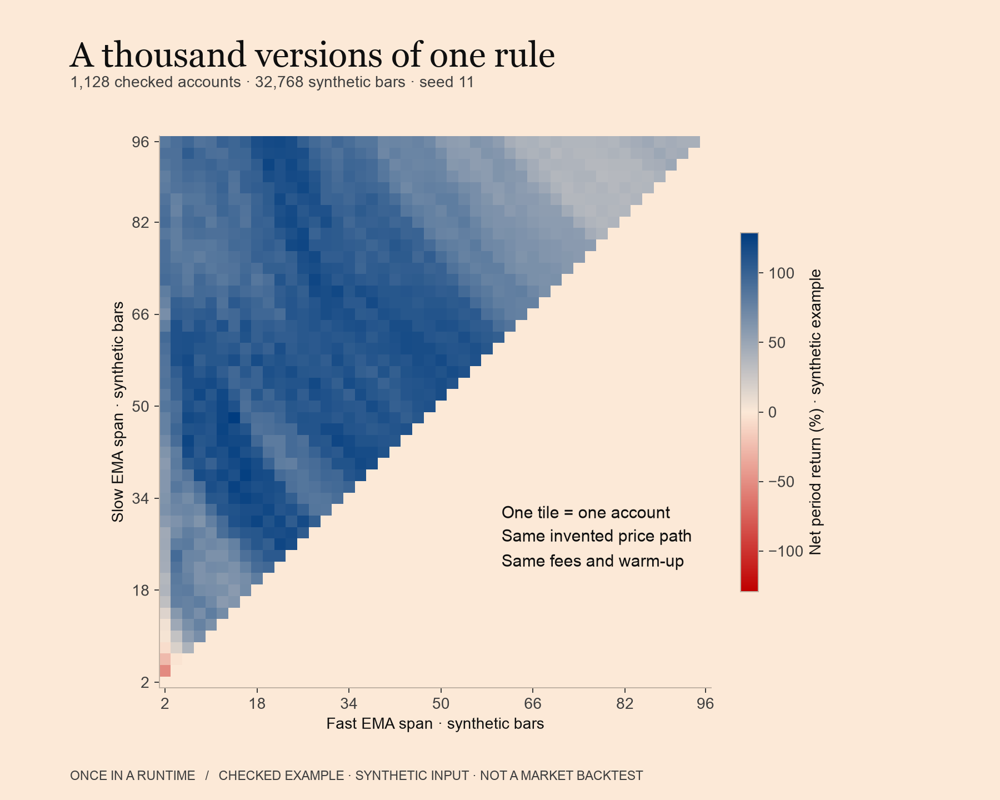
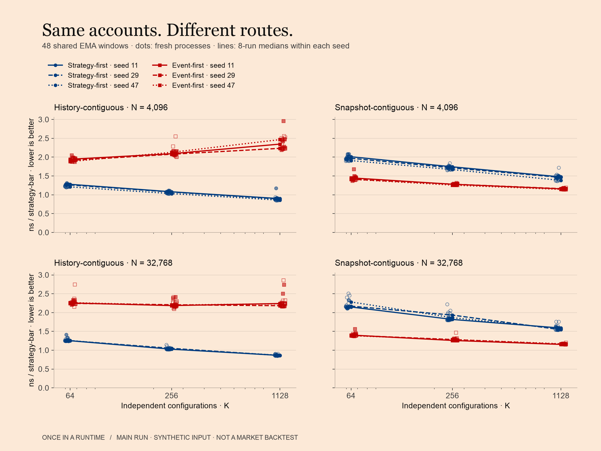
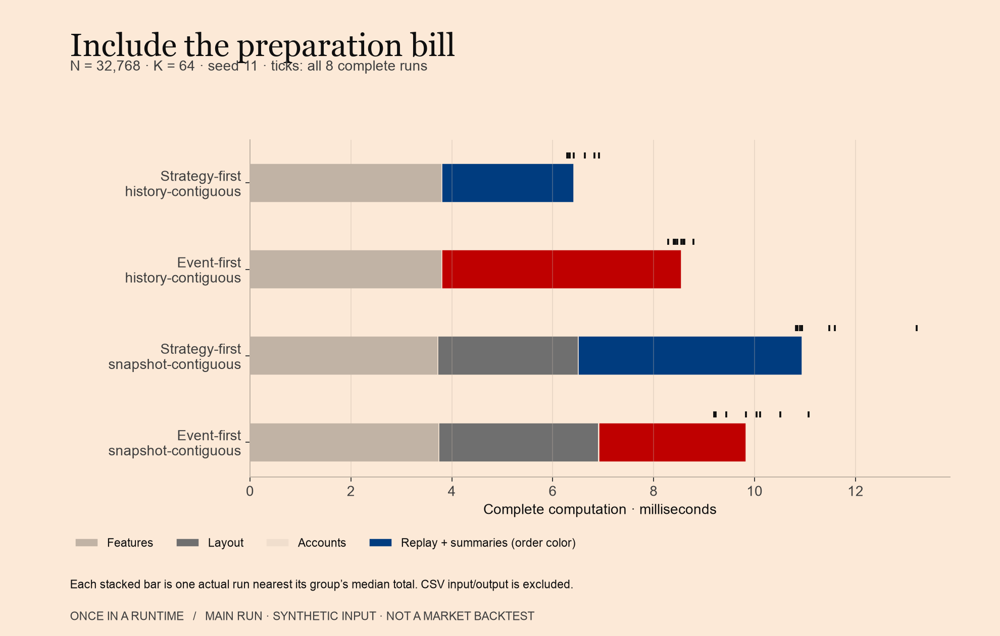

# One market, a thousand strategies: which way should the loop run?

*A C++ experiment about replaying trading rules, arranging data, and the work behind a parameter search.*

> Working draft, 16 November 2026. The implementation, independent checks and 576-observation main campaign are complete. Figures use checked synthetic outputs and retained measurements. Host load increased during timing; the conclusions below are scoped to this run and these workloads.

## One rule, quite a few settings

Suppose you have a trading rule simple enough to explain over coffee: hold a stock while its recent trend looks stronger than its longer-term trend, and sit out when that changes. Before getting too attached to it, you would probably want to try a few settings. How recent is recent? How long should the longer trend be?

Those two choices give us a grid to explore. With 48 possible settings for our smoothed price, there are 1,128 ways to choose a shorter and a longer one. Each pair gives us a version of the same rule, all looking at the same price history. The computer is perfectly happy to keep trying; deciding what to make of the results is our problem.

This is where my interest in trading meets the sort of question I can investigate in C++. The straightforward implementation is to pick a pair, replay the history, save the result, and move on to the next pair. But we could also read the first market event, update every version of the strategy, and then move to the next event. Each strategy would still see its own history in order. We would be taking a different route through the same work.

I want to find out what that route costs once each strategy has an account to update and some results to produce. There is also a second choice underneath the loops: how the values they read are arranged in memory. C++23's `mdspan` gives us a way to make that choice explicit without changing the coordinates we use to access them.



*Each tile is one account using a different fast/slow pair. These are computed results on an invented 32,768-bar price path, with the same fees and warm-up throughout. The generator includes alternating drift; the blue regions describe that artificial example. They say nothing about whether this rule would make money in a market.*

## Give each strategy its own little account

An exponential moving average, or EMA, smooths a price by combining the latest observation with its previous smoothed value. We will use:

```text
EMA[t] = alpha * close[t] + (1 - alpha) * EMA[t - 1]
alpha  = 2 / (span + 1)
```

A shorter span gives the latest price more weight, so its average reacts more quickly. Our rule holds the asset when the fast average is above the slow one, and holds cash otherwise. A 10-bar/30-bar pair and a 12-bar/40-bar pair are two configurations. A bar is one time interval with an opening and closing price. Here the bars are generated time steps, with no claim that they reproduce a particular market or trading interval.

Each configuration gets its own simulated account. They share the price history and indicator values, but each has its own cash, holding and record of what happened. This independence is what will let us rearrange their updates. If two strategies competed for the same cash or the same available fill, changing their order could change the answer.

There is one timing detail to get right before worrying about the computer's clock. A signal calculated from Monday's closing price can affect the trade at Tuesday's open in our model. It cannot buy at Monday's open using information from later that day. So each update first carries out the previous completed bar's instruction, values the account at the current close, and prepares the next instruction.

For example, suppose an account has 1,000 in cash and its previous signal says to buy. At an opening price of 100, it buys 10 shares if we temporarily ignore fees. If the close is 102, the account is worth 1,020. A sell signal calculated from that close will wait until the following open. If it opens at 99, those shares sell for 990. The overnight move belongs in the result; rearranging our loops must preserve it too.

The checked engine charges one basis point on each side, allows fractional shares, and sells any remaining holding at the final close. With the fee included, our little account buys about 9.999 shares and finishes with 989.80. The fee-free numbers above make the sequence easier to follow; the [runnable five-bar example](examples/account.md) shows the full arithmetic. The [experiment brief](brief.md) fixes these rules for all four implementations.

## Two ways to walk through the work

Imagine a spreadsheet with market events down the rows and strategy configurations across the columns. We can finish one column before starting the next, or finish one row before moving down. Either way, every individual strategy travels from the top of its column to the bottom.

The strategy-first route keeps one account in hand while it works through the history. The event-first route keeps returning to a collection of accounts while advancing through the market events. That gives us a tradeoff to examine: access to the market features on one side, and access to strategy state on the other.


*Both routes preserve time order inside each account. The upper grids show strategy updates; the lower strips show a different table, the shared EMA features. The arrows describe logical operations, not elapsed time.*

Here is a simplified version of the implemented loops. `step` contains the same accounting in both. Notice the `t - 1`: that is the completed close whose signal can trade at the current open.

```cpp
for (std::size_t s = 0; s < configs.size(); ++s) {
    auto state = states[s];
    const auto config = configs[s];
    for (std::size_t t = first_bar; t < bars.size(); ++t) {
        const bool target = features[t - 1, config.fast]
                          > features[t - 1, config.slow];
        step(state, target, bars[t], t + 1 == bars.size(), rules);
    }
    states[s] = state;
}

for (std::size_t t = first_bar; t < bars.size(); ++t) {
    for (std::size_t s = 0; s < configs.size(); ++s) {
        const auto config = configs[s];
        const bool target = features[t - 1, config.fast]
                          > features[t - 1, config.slow];
        step(states[s], target, bars[t], t + 1 == bars.size(), rules);
    }
}
```

Before either loop starts, we calculate each distinct EMA once. Many pairs reuse the same average, so recalculating it for every strategy would make the comparison unnecessarily expensive. Both traversal orders get the same shared feature values and produce a result for every configuration, in the same configuration order. The first route keeps its current account local until its history is finished; the second keeps returning to the account array.

## The other table, and where `mdspan` fits

The feature table is different from the spreadsheet of strategy updates. Its rows are bars, but its columns are EMA windows. A thousand configurations can share a few dozen indicator columns.

Take three bars and just two indicator columns, A and B:

```text
             A    B
bar 0       A0   B0
bar 1       A1   B1
bar 2       A2   B2

History together:   A0 A1 A2 B0 B1 B2
Snapshot together:  A0 B0 A1 B1 A2 B2
```

In the first arrangement, following one indicator through time takes us through neighboring values. In the second, neighboring values describe different indicators at the same event. Both represent the same logical table.

Here is the C++ view we can use for either:

```cpp
template<class Layout>
using FeatureView = std::mdspan<const double,
                              std::dextents<std::size_t, 2>, Layout>;
```

The backing buffer owns the numbers; `mdspan` holds the information needed to find them. With logical dimensions `[bar, window]`, `layout_left` puts successive bars next to each other. `layout_right` puts successive windows next to each other. In both cases, the expression is `features[t, w]`. These mappings follow the [standard layout definitions](https://eel.is/c%2B%2Bdraft/mdspan.layout.left.overview) and [their right-layout counterpart](https://eel.is/c%2B%2Bdraft/mdspan.layout.right.overview).

For N bars and W windows, the underlying offsets are `t + N * w` and `t * W + w`. The policy makes those mappings explicit. It does not turn one backing array into the other. If we change the view without arranging the data to match, we read different values. The owner must also remain alive, without an invalidating reallocation, for as long as we use its view.

The [small runnable example](examples/layout.cpp) checks this with six invented values, both sets of strides and a deliberately mismatched view. It builds on my existing GCC 16.2 setup in C++23 mode and passes sanitizer checks. [GCC's release notes](https://gcc.gnu.org/gcc-16/changes.html) list `mdspan` support; the local check establishes that the particular form used here works. It says nothing yet about backtest speed or the cost of the abstraction.

That leaves four combinations:

| Traversal | Feature storage |
| --- | --- |
| Finish one strategy's history at a time | One indicator's history together |
| Finish one strategy's history at a time | One event's indicator snapshot together |
| Update every strategy for one event at a time | One indicator's history together |
| Update every strategy for one event at a time | One event's indicator snapshot together |

The state representation, strategy ordering and arithmetic stay fixed. This lets us ask about traversal and layout separately. `mdspan` is how we express the layout choice here; there is no raw-pointer-versus-view comparison, and no assumed SIMD benefit.

## Check the accounts before timing the loops

Before trusting a timer, we need to trust the accounts. Small fixtures now check every decision, holding, fee and equity mark against a separate Python transaction ledger. Matching the final return alone would leave too much room for two different histories to happen to end at the same number. These cases include an overnight gap, equality between indicators, no trades, and a position still open at the end. Changing a bar's close also has its own check: it must leave that bar's opening decision alone.

All four C++ variants produced identical outputs in those checks. The larger untimed runs also matched the independent summaries at 4,096 and 32,768 bars, three synthetic input seeds, and 64, 256 or 1,128 configurations. The [reproduction guide](benchmark.md) records the precise checks and floating-point tolerance. With that foundation in place, we can look at the timings.

The primary interval covers replay and construction of the ordered summaries. Dividing by the number of configurations times the number of eligible bars gives us nanoseconds per strategy-bar: the cost of updating one configuration for one event, averaged over the replay. It is a throughput measure derived from the full interval, not the latency of an individual market event.



*Each dot is one fresh process. Lines join eight-run medians within each seed, across the three measured configuration counts. All 48 feature windows are present at every count. The 576 observations are retained, including slower ones.*

The ordering changes with the storage layout. With an indicator's history together, strategy-first has the lower median in every tested workload and seed. With an event's indicator snapshot together, event-first has the lower median. Across all four combinations, strategy-first/history is lowest in all eighteen workload/seed cells.

For one concrete case, 32,768 bars and 1,128 configurations on seed 11, the median prepared intervals are about 31.75 ms for strategy-first/history and 82.56 ms for event-first/history. With snapshot storage, the corresponding medians are 58.55 and 42.54 ms. Changing the loop order without asking how its input is stored would miss the reversal.

These are observations from my Apple M3 setup, with an important limit. The run started after a full minute of low recorded load, but the system's one-minute load average later rose from 2.27 at entry to 36.12. CPU placement and frequency were uncontrolled. The dots show the observed spread; this experiment does not promise those timings on an isolated machine, another processor or a live trading system.

The compiler report also helps keep the explanation honest. GCC 16.2 reports no loop vectorization in the replay function, while identifying some vectorized basic-block operations. We have evidence for the layout-dependent ordering here. Explaining it specifically through cache misses, memory bandwidth or SIMD would require more evidence.

I also want the complete computation cost: preparing the features in the required storage order, setting up the accounts, replaying the history, and producing the summaries. The clock starts with already-parsed bars and stops before writing CSV files. A layout that helps the replay may take work to prepare. Here, snapshot storage needs a conversion from the shared canonical feature table, with an extra allocation during that conversion. Whether that cost is useful depends partly on how often the prepared features can be reused.



*The largest history and smallest sweep make the preparation bill visible. Each stack is one actual run nearest its group's median total; ticks show all eight complete-run totals. Blue and red identify the traversal; gray segments show preparation. Input parsing and CSV writing are outside this interval.*

At 64 configurations on the same seed, strategy-first/history and event-first/snapshot have median prepared intervals of about 2.62 and 2.93 ms. Include preparation and those medians become 6.38 and 9.94 ms. The preparation choice matters much more when fewer accounts share its cost. Snapshot conversion also temporarily needs another feature matrix: at this history length, that is an extra 12 MiB. A different preparation algorithm or an already prepared snapshot would change this bill; neither was varied in this comparison.

## What this could change in a research tool

For this bounded parameter-sweep tool, strategy-first with history-contiguous features is the starting point supported by the measured medians. If a surrounding application already provides snapshot-contiguous features, the comparison within that layout favors event-first. Whether to pay for a conversion is a separate question involving preparation and reuse. This is the sort of choice that comes up when trying signal settings or replaying scenarios in a research application.

A shared portfolio or an execution simulator with competition for fills would need its dependencies examined before applying the same loop transformation. Our freedom to rearrange the work comes from independent accounts reading shared, immutable inputs.

Making these runs faster also makes it easier to try more settings until something looks convincing. Even on observed market prices, a parameter heatmap describes the chosen history. Its brightest tile does not establish a good strategy for the next one. Bailey and colleagues discuss this selection problem in [*The Probability of Backtest Overfitting*, February 2015](https://www.davidhbailey.com/dhbpapers/backtest-prob.pdf).

The useful lesson for me is to make the traversal and storage decisions together, then count the preparation that makes them possible. `mdspan` lets the code state those storage choices through the same logical coordinates. The account checks tell us whether we still did the same financial work; the measurements tell us what that particular route cost under the recorded conditions.

## Reproducing the experiment

The [reproduction guide](benchmark.md) includes build commands, accounting checks, frozen pilot/main matrices, timing boundaries and memory accounting. The [findings](findings.md) and [individual observations](results/README.md) record outcomes and limits. C++ uses GCC 16.2 with `-O3 -fno-fast-math -ffp-contract=off` for the release build; debug and sanitizer checks are separate. All accounts share a 96-bar warm-up, with 48 windows held fixed while the nested configuration set grows. The input generator, seeds, reference summaries, actual source/build hashes and every process observation are retained.
