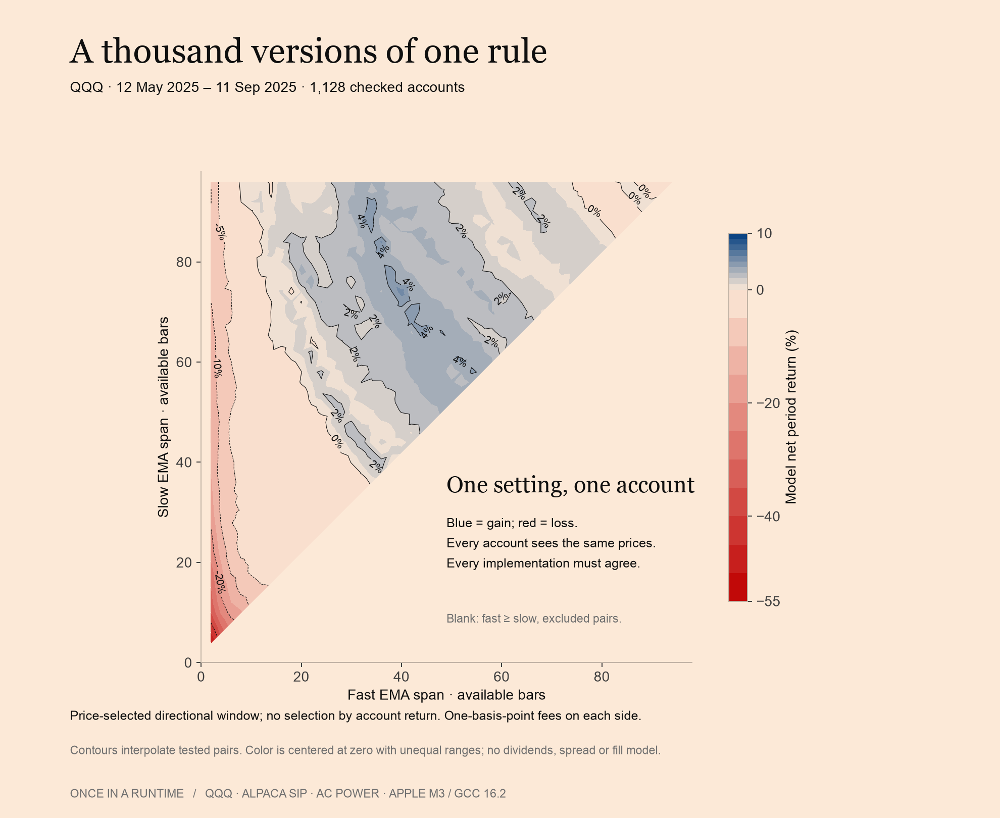
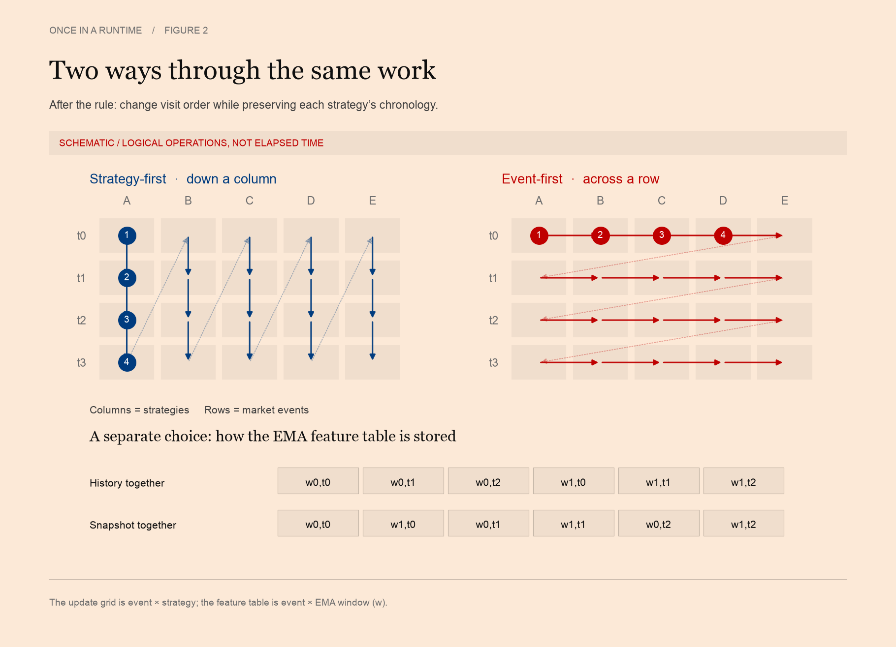
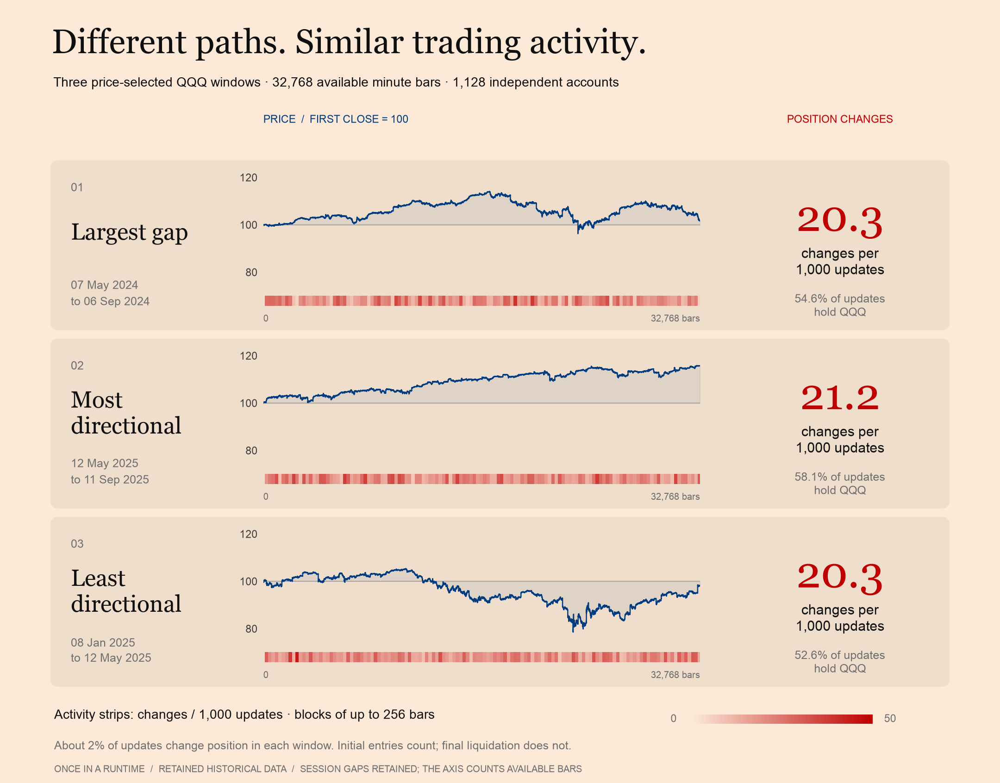
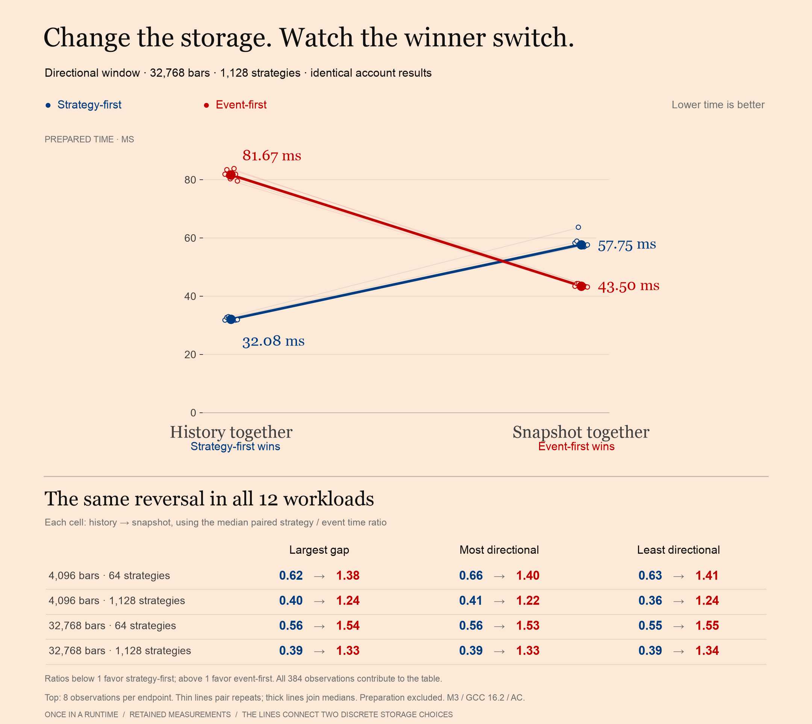
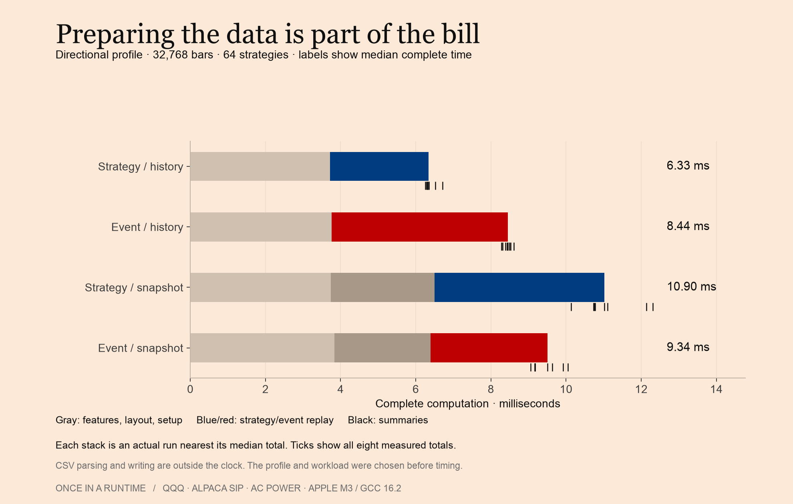

# One market, a thousand strategies: which way should the loop run?

*A C++ experiment about replaying trading rules, arranging data, and the work behind a parameter search.*

> Working draft, 19 November 2026. Measurements and code inspection completed on 17 November; this revision clarifies the takeaway and integrates the account-file illustration. Figures below use checked QQQ inputs and the historical AC campaign. Earlier synthetic campaigns remain separate supporting evidence.

## One rule, quite a few settings

Suppose you have a trading rule simple enough to explain over coffee: hold a stock while its recent trend looks stronger than its longer-term trend, and sit out when that changes. Before getting too attached to it, you would probably want to try a few settings. How recent is recent? How long should the longer trend be?

Those two choices give us a grid to explore. With 48 possible settings for our smoothed price, there are 1,128 ways to choose a shorter and a longer one. Each pair gives us a version of the same rule, all looking at the same price history. The computer is perfectly happy to keep trying; deciding what to make of the results is our problem.

This is where my interest in trading meets the sort of question I can investigate in C++. The straightforward implementation is to pick a pair, replay the history, save the result, and move on to the next pair. But we could also read the first market event, update every version of the strategy, and then move to the next event. Each strategy would still see its own history in order. We would be taking a different route through the same work.

I want to find out what that route costs once each strategy has an account to update and some results to produce. There is also a second choice underneath the loops: how the values they read are arranged in memory. C++23's `mdspan` gives us a way to make that choice explicit without changing the coordinates we use to access them.

As it turns out, changing that arrangement changes which loop is faster in these tests, even though every account finishes with the same result. Following the account through the loops will help us see what changes, and why the storage choice belongs in the same decision.



*Each tested pair has its own account, using 32,768 QQQ minute bars from 12 May to 11 September 2025. The window was chosen from prices, before looking at account returns. Contours interpolate between tested pairs; the color scale is centered at zero with different positive and negative ranges. These are results of our simplified account model, without dividends, spreads or a fill model.*

## Give each strategy its own little account

An exponential moving average, or EMA, smooths a price by combining the latest observation with its previous smoothed value. We will use:

```text
EMA[t] = alpha * close[t] + (1 - alpha) * EMA[t - 1]
alpha  = 2 / (span + 1)
```

A shorter span gives the latest price more weight, so its average reacts more quickly. Our rule holds the asset when the fast average is above the slow one, and holds cash otherwise. A 10-bar/30-bar pair and a 12-bar/40-bar pair are two configurations. A bar is one time interval with an opening and closing price. For the historical test, each bar is an available regular-session minute of QQQ trading. The span counts bars, so a 30-bar average crosses an overnight gap without pretending that the market traded continuously.

Each configuration gets its own simulated account. They share the price history and indicator values, but each has its own cash, holding and record of what happened. This independence is what will let us rearrange their updates. If two strategies competed for the same cash or the same available fill, changing their order could change the answer.

There is one timing detail to get right before worrying about the computer's clock. A signal calculated when the 9:30 minute finishes can affect the trade at the 9:31 open in our model. It cannot buy at the 9:30 open using information from later in that minute. The last signal of a session can carry through to the next session's open. So each update first carries out the previous completed bar's instruction, values the account at the current close, and prepares the next instruction.

For example, suppose an account has 1,000 in cash and its previous signal says to buy. At an opening price of 100, it buys 10 shares if we temporarily ignore fees. If the close is 102, the account is worth 1,020. A sell signal calculated from that close will wait until the following open. If it opens at 99, those shares sell for 990. The overnight move belongs in the result; rearranging our loops must preserve it too.

The checked engine charges one basis point on each side, allows fractional shares, and sells any remaining holding at the final close. With the fee included, our little account buys about 9.999 shares and finishes with 989.80. The fee-free numbers above make the sequence easier to follow; the [runnable five-bar example](examples/account.md) shows the full arithmetic. The [experiment brief](brief.md) fixes these rules for all four implementations.

## Two ways to walk through the work

Imagine a spreadsheet with market events down the rows and strategy configurations across the columns. We can finish one column before starting the next, or finish one row before moving down. Either way, every individual strategy travels from the top of its column to the bottom.

The strategy-first route keeps one account in hand while it works through the history. The event-first route keeps returning to a collection of accounts while advancing through the market events. That gives us a tradeoff to examine: access to the market features on one side, and access to strategy state on the other.



*Both routes preserve time order inside each account. The upper grids show strategy updates; the lower strips show a different table, the shared EMA features. The arrows describe logical operations, not elapsed time.*

Here is a simplified version of the implemented loops. `step` contains the same accounting in both. Notice the `t - 1`: that is the completed close whose signal can trade at the current open.

```cpp
for (std::size_t s = 0; s < configs.size(); ++s) {
    auto state = states[s];
    const auto config = configs[s];
    for (std::size_t t = first_bar; t < bars.size(); ++t) {
        const bool target = features[t - 1, config.fast]
                          > features[t - 1, config.slow];
        step(state, target, bars[t], t + 1 == bars.size(), rules);
    }
    states[s] = state;
}

for (std::size_t t = first_bar; t < bars.size(); ++t) {
    for (std::size_t s = 0; s < configs.size(); ++s) {
        const auto config = configs[s];
        const bool target = features[t - 1, config.fast]
                          > features[t - 1, config.slow];
        step(states[s], target, bars[t], t + 1 == bars.size(), rules);
    }
}
```

Before either loop starts, we calculate each distinct EMA once. Many pairs reuse the same average, so recalculating it for every strategy would make the comparison unnecessarily expensive. Both traversal orders get the same shared feature values and produce a result for every configuration, in the same configuration order. The first route keeps its current account local until its history is finished; the second keeps returning to the account array.

## The other table, and where `mdspan` fits

The feature table is different from the spreadsheet of strategy updates. Its rows are bars, but its columns are EMA windows. A thousand configurations can share a few dozen indicator columns.

Take three bars and just two indicator columns, A and B:

```text
             A    B
bar 0       A0   B0
bar 1       A1   B1
bar 2       A2   B2

History together:   A0 A1 A2 B0 B1 B2
Snapshot together:  A0 B0 A1 B1 A2 B2
```

In the first arrangement, following one indicator through time takes us through neighboring values. In the second, neighboring values describe different indicators at the same event. Both represent the same logical table.

Here is the C++ view we can use for either:

```cpp
template<class Layout>
using FeatureView = std::mdspan<const double,
                              std::dextents<std::size_t, 2>, Layout>;
```

The backing buffer owns the numbers; `mdspan` holds the information needed to find them. With logical dimensions `[bar, window]`, `layout_left` puts successive bars next to each other. `layout_right` puts successive windows next to each other. In both cases, the expression is `features[t, w]`. These mappings follow the [standard layout definitions](https://eel.is/c%2B%2Bdraft/mdspan.layout.left.overview) and [their right-layout counterpart](https://eel.is/c%2B%2Bdraft/mdspan.layout.right.overview).

For N bars and W windows, the underlying offsets are `t + N * w` and `t * W + w`. The policy makes those mappings explicit. It does not turn one backing array into the other. If we change the view without arranging the data to match, we read different values. The owner must also remain alive, without an invalidating reallocation, for as long as we use its view.

The [small runnable example](examples/layout.cpp) checks this with six invented values, both sets of strides and a deliberately mismatched view. It builds on my existing GCC 16.2 setup in C++23 mode and passes sanitizer checks. [GCC's release notes](https://gcc.gnu.org/gcc-16/changes.html) list `mdspan` support; the local check establishes that the particular form used here works. It says nothing yet about backtest speed or the cost of the abstraction.

That leaves four combinations:

| Traversal | Feature storage |
| --- | --- |
| Finish one strategy's history at a time | One indicator's history together |
| Finish one strategy's history at a time | One event's indicator snapshot together |
| Update every strategy for one event at a time | One indicator's history together |
| Update every strategy for one event at a time | One event's indicator snapshot together |

The state representation, strategy ordering and arithmetic stay fixed. This lets us ask about traversal and layout separately. `mdspan` is how we express the layout choice here; using it does not imply a SIMD benefit.

Writing `features[t, w]` is convenient, but I also wanted to check what happened if we wrote the offsets ourselves. So I built the same engine both ways, keeping the runtime dimensions, loops and account updates unchanged. In this GCC 16.2 release build, the generated address calculations and memory accesses were identical. The compiler swapped operands in a handful of arithmetic and comparison instructions, but writing the indexing by hand saved no instructions in the complete replay function.

Both versions also produced identical results for all 1,128 accounts on the selected QQQ window, and passed the boundary and sanitizer checks. A small timing pilot encountered rising background load, so I would not turn it into a percentage claim about overhead. The useful finding is narrower: for these views and this kernel, the clearer coordinates did not add instructions. The [separate access check](mdspan-check.md) retains the code comparison and every timing sample.

## Check the accounts before timing the loops

Before trusting a timer, we need to trust the accounts. Small fixtures now check every decision, holding, fee and equity mark against a separate Python transaction ledger. Matching the final return alone would leave too much room for two different histories to happen to end at the same number. These cases include an overnight gap, equality between indicators, no trades, and a position still open at the end. Changing a bar's close also has its own check: it must leave that bar's opening decision alone.

All four C++ variants produced identical outputs in those checks. Two excerpts from the historical data also passed every feature, trace and summary check, including an overnight boundary. Then all 48 full-size historical cases matched the independent summaries: three profiles, two history lengths, two configuration counts and four implementations. The [reproduction guide](benchmark.md) records the precise checks and floating-point tolerance.

## Let the same code see different histories

The first runs used generated prices. That made the inputs easy to reproduce, but I also wanted to know whether the result survived a few different pieces of market history. A steadily rising price and a sharp fall can give the accounts different instructions, even though the source code is unchanged.

For this extension, I used the supplied Alpaca SIP export of QQQ one-minute bars from 2023 through 2025. The provider's [split adjustment](https://docs.alpaca.markets/us/reference/stockbarsingle-1) applies consistently to the prices. After filtering to regular sessions, including early closes, the audit found 291,840 expected minutes with none missing. Overnight and weekend gaps remain gaps; no prices were filled in.

I divided that history into eight complete blocks of 32,768 bars, leaving the incomplete tail out. The selection rule first picks the largest consecutive-close gap, then the most directional remaining block, then the least directional remaining block. Here, directionality means how much of the price's total back-and-forth movement survives as a net move from start to finish. Strategy returns and runtimes play no part in the selection.



*Each card shows a selected history, normalized to its first close and drawn on the same price scale. Red strips show position changes per 1,000 updates in blocks of up to 256 bars; the large number summarizes all eligible updates across 1,128 accounts. Holding percentages also refer to updates. Initial entries count; forced final liquidation does not. The largest gap crosses the weekend of 2–5 August 2024, rather than representing a one-minute price move.*

There is a useful wrinkle here. The paths look quite different, but the complete strategy grid changes position at roughly 20–21 of every 1,000 updates in all three. The fraction of updates holding QQQ ranges from about 53% to 58%. So this extends the test to different historical prices, while giving us only modest variation in these measures of account activity. Calling them three radically different computational regimes would oversell the evidence.

Each long history also supplies a nested 4,096-bar crop. Both sizes start their EMA values and accounts independently. Changing the size therefore changes the selected path and initialization as well as the amount of data; it is not a clean experiment on cache capacity alone.

## The storage choice changes which loop wins

The primary interval covers replay and construction of the ordered summaries. It measures a complete sweep over prepared features, rather than the latency of an individual market event. There are eight fresh-process observations for each combination of profile, history length, configuration count and implementation: 384 observations in total.



*The upper chart uses the directional window with 32,768 bars and 1,128 accounts. Blue is strategy-first; red is event-first. Small points retain eight observations at each endpoint, thin lines pair repetitions, and thick lines join medians across the two discrete layouts. The table shows history → snapshot for each workload, using median paired strategy/event time ratios: below 1 favors strategy-first, above 1 favors event-first. All 384 observations contribute to those summaries and remain available in the results. Preparation is outside this interval.*

The storage-dependent ordering repeated in all twelve historical workload cells: three price profiles, two history lengths and two configuration counts. With each indicator's history together, strategy-first had the lower median. With each event's indicator snapshot together, event-first had the lower median. Across all four combinations, strategy-first/history was lowest in every cell. **For this sweep, choosing the faster loop means choosing it together with the feature layout.** All four routes still produced identical account results.

For a concrete example, take the directional profile with 32,768 bars and 1,128 configurations. The median prepared intervals were 32.08 ms for strategy-first/history and 81.67 ms for event-first/history. With snapshot storage, the corresponding medians were 57.75 and 43.50 ms. Changing the loop order without asking how its input is stored would miss the reversal.

These measurements came from my Apple M3 setup on AC power. After the required minute of low recorded load, the measured phase took about 19.5 seconds; its recorded one-minute load average stayed between 1.98 and 2.14. CPU placement and frequency were still uncontrolled. Earlier synthetic campaigns showed the same ordering, including a separate battery run, but their timings and conditions remain separate in the [results](results/README.md).

## Keep one account in hand

Changing loop order also changes how long an account's working state stays in registers. The compiler report helps us inspect that part of the story: GCC 16.2 reports no loop vectorization in the replay function, while identifying some vectorized basic-block operations. Looking at the generated instructions reveals where the account lives while we work on it.

Think of working through a stack of account files. Strategy-first keeps one file open while following its history; in this compiled loop, the account fields stay in registers across bars. Event-first fetches a file, updates it, puts it back and moves to the next account, returning to the collection for the next bar. The steady event-first paths I inspected read 32 bytes of account fields and write 16 bytes back, even when no trade happens. Cash and shares may be unchanged, but the account still needs an equity mark, a running peak and a drawdown calculation. There is a division in that update even when the trading decision is simply “carry on.”


*The files and A/B/C accounts are schematic. Byte counts describe explicit account-field loads and stores in the reviewed steady cash/long paths; caches may serve them. The blue 0 B applies inside that steady update: strategy-first still loads and stores the account at the history's boundaries. Startup, trades and final liquidation take different paths.*

Keeping an account in registers is one advantage we can see in the code. It does not settle which loop wins: event-first has more instructions on those steady paths and still wins with snapshot storage. Changing the traversal changes both the input access pattern and the lifetime of the account in registers, and the timings reflect their combined effect. The instruction inspection establishes those code differences; it does not measure DRAM traffic or assign a share of runtime to any one of them. Cache behaviour, branch prediction and instruction dependencies need further profiling before we can quantify their contribution. The [mechanism report](mechanism-check.md) records what we could establish with the current tools and what remains open.

## Count the preparation, too

I also want the complete computation cost: preparing the features in the required storage order, setting up the accounts, replaying the history, and producing the summaries. The clock starts with already-parsed bars and stops before writing CSV files. A layout that helps the replay may take work to prepare. Here, snapshot storage needs a conversion from the shared canonical feature table, with an extra allocation during that conversion. Whether that cost is useful depends partly on how often the prepared features can be reused.



*The directional profile, largest history and smallest sweep were chosen for this view before timing. Each stack is one actual run nearest its group's median total; ticks show all eight complete-run totals. Blue and red identify strategy-first and event-first replay; gray segments show preparation. Input parsing and CSV writing are outside this interval.*

At 64 configurations on this directional profile, strategy-first/history and event-first/snapshot have median prepared intervals of about 2.63 and 2.97 ms. Include preparation and those medians become 6.33 and 9.34 ms. The preparation choice matters much more when fewer accounts share its cost. Snapshot conversion also temporarily needs another feature matrix: at this history length, that is an extra 12 MiB. A different preparation algorithm or an already prepared snapshot would change this bill; neither was varied in this comparison.

## What this could change in a research tool

For this bounded parameter-sweep tool, strategy-first with history-contiguous features is the starting point supported by the measured medians. If a surrounding application already provides snapshot-contiguous features, the comparison within that layout favors event-first. Whether to pay for a conversion is a separate question involving preparation and reuse. This is the sort of choice that comes up when trying signal settings or replaying scenarios in a research application.

A shared portfolio or an execution simulator with competition for fills would need its dependencies examined before applying the same loop transformation. Our freedom to rearrange the work comes from independent accounts reading shared, immutable inputs.

Making these runs faster also makes it easier to try more settings until something looks convincing. Even on observed market prices, a parameter heatmap describes the chosen history. Its brightest tile does not establish a good strategy for the next one. Bailey and colleagues discuss this selection problem in [*The Probability of Backtest Overfitting*, February 2015](https://www.davidhbailey.com/dhbpapers/backtest-prob.pdf).

The result I would carry into that research tool is specific: for these independent EMA accounts, strategy-first was faster with history storage, event-first was faster with snapshot storage, and strategy-first/history was the fastest combination tested. That held across all twelve historical workloads on this machine and compiler, with identical account results.

The useful habit is to make the traversal and storage decisions together, then count the preparation that makes them possible. Keeping one account open is part of the explanation; we also have to follow the market features it reads. `mdspan` lets the code express those storage choices through the same logical coordinates. The account checks tell us whether we still did the same financial work, and the measurements tell us what that particular route cost under the recorded conditions.

## Reproducing the experiment

The [reproduction guide](benchmark.md) includes build commands, accounting checks, frozen pilot/main matrices, timing boundaries and memory accounting. The [findings](findings.md) and [individual observations](results/README.md) record outcomes and limits. C++ uses GCC 16.2 with `-O3 -fno-fast-math -ffp-contract=off` for the release build; debug and sanitizer checks are separate. All accounts share a 96-bar warm-up, with 48 windows held fixed while the nested configuration set grows. The historical input manifest, price-only selection scores, dataset hashes, reference summaries, actual source/build snapshots and every process observation are retained. Raw market exports stay local; the repository includes derived results and acquisition instructions. The earlier synthetic inputs and seeds remain separately documented.
